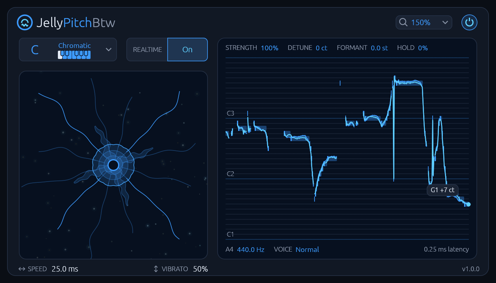

# JellyPitchBtw

**Pitch correction for one voice, steered by a jellyfish.** One puck sets how fast a note is
pulled in and how much of the singing round it is left alone, and a display shows the voice as
sung and as corrected. CLAP for Linux.



Pick the key and scale, and every note is drawn to the nearest one in it. Drag the puck left for a
hard, robotic snap and right for a slow, natural glide; up keeps the vibrato, down irons it flat.
The note is chosen from its centre, so a wide vibrato stays on its note instead of hopping to the
next. REALTIME is 0.25 ms behind, for singing through it; off, the plugin looks ahead so each
correction lands on the start of its note, for mixing and bouncing. It is not a harmoniser and not
a vocoder: it corrects one voice at a time.

**[Read the manual](manual.md)** for every control and how to use it.

## Features

- **13 scales in every key:** Chromatic, Major, Natural, Harmonic and Melodic Minor, Dorian, Phrygian, Lydian, Mixolydian, Locrian, Major and Minor Pentatonic and Blues.
- **One puck for the feel:** SPEED from 1 to 200 ms along the pad, VIBRATO from 0 to 100 % up it. Double-click it for the middle, 25 ms and 50 %.
- **The note through a vibrato:** a ±60 cent vibrato stays on one note, with VIBRATO at 0, 50 or 100 %.
- **Two latencies:** REALTIME, 0.25 ms (12 samples at 48 kHz), or Quality, a look-ahead of 16 to 43.5 ms by voice range, reported to the host so the track stays in time.
- **A display that shows what it does:** the last four seconds, the voice as sung and as corrected, with STRENGTH, DETUNE, FORMANT and its HOLD, A4 and the voice range set right in it.
- **Formants:** move them up to 12 semitones either way, and choose how far they stay put while the pitch moves.
- **A jellyfish that listens:** its bell pulses with your level and its tentacles stir the further you are off the note, calm within 5 cents.
- **Light:** 0.13 % of a CPU core at the defaults.
- **Zoom** from 100 to 200 %.
- **No network access and no telemetry.**

## Install

Download the latest version from the [Releases page](https://github.com/jelly-comet/JellyPitchBtw-release/releases),
or with these commands:

```bash
curl -LO https://github.com/jelly-comet/JellyPitchBtw-release/releases/download/v1.0.0/JellyPitchBtw-1.0.0-linux-x86_64.tar.gz
curl -LO https://github.com/jelly-comet/JellyPitchBtw-release/releases/download/v1.0.0/JellyPitchBtw-1.0.0-linux-x86_64.tar.gz.sha256
sha256sum -c JellyPitchBtw-1.0.0-linux-x86_64.tar.gz.sha256 && tar xzf JellyPitchBtw-1.0.0-linux-x86_64.tar.gz
cd JellyPitchBtw-1.0.0-linux-x86_64
```

Install for your user:

```bash
mkdir -p ~/.clap
rm -f ~/.clap/JellyPitchBtw.clap && cp JellyPitchBtw.clap ~/.clap/
```

Or for all users:

```bash
sudo mkdir -p /usr/lib/clap
sudo rm -f /usr/lib/clap/JellyPitchBtw.clap && sudo cp JellyPitchBtw.clap /usr/lib/clap/
```

Removing the old copy first avoids overwriting a file a running host has loaded. Then rescan plugins
in your DAW.

To uninstall:

```bash
rm -f ~/.clap/JellyPitchBtw.clap
```

## Requirements

- Linux x86-64 with glibc 2.31 or newer (Ubuntu 20.04, Debian 11, Fedora 32 and newer)
- A CLAP host
- X11 or XWayland, and a Vulkan driver for the editor

Releases contain the CLAP plugin only.

## License

MIT, see [LICENSE](LICENSE). The licenses of the third-party code in the binaries are in
`THIRD-PARTY-LICENSES.txt` in each release archive.

CLAP is an open standard by the free-audio project. JellyPitchBtw is an independent project, not
affiliated with or endorsed by the makers of any other pitch correction.
