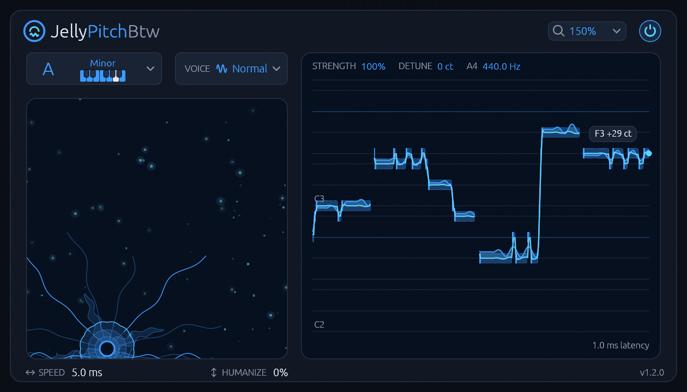

# JellyPitchBtw manual

**Pitch correction for one voice, steered by a jellyfish.** One puck sets how fast a note is
pulled in and how far off its note a voice may be and be left alone, and a display shows the voice
as sung and as corrected.

Version 1.3.0. To install it, see the [install steps](README.md#install).

## Contents

- [Getting started](#getting-started)
- [The controls](#the-controls)
- [How to use it](#how-to-use-it)
- [Good to know](#good-to-know)
- [Troubleshooting](#troubleshooting)

## Getting started

Put JellyPitchBtw on a track with one voice on it: a lead vocal, a backing vocal, a solo
instrument that plays one note at a time. Choose the song's key and scale at the top left, play
the track, and watch the display: the blue line is the voice as sung, the bright line as it comes
out, and each note it is pulled to sits behind them as a bar.

At the defaults (the puck at the bottom of the pad, half way across) a note is pulled in over
25 ms and every note is corrected. Drag the puck to the bottom left corner to hear the hard,
robotic snap; up and to the right for a correction you barely notice.

## The controls

From the top left of the window.

| Control | Range | Default | What it does |
| --- | --- | --- | --- |
| **Power switch** (top right) | On / Off | On | Off, the voice passes through uncorrected, as late as the latency the plugin reports, so the track stays in time. |
| **Key and scale** | C to B; 13 scales | C, Chromatic | The notes a voice is pulled to. Chromatic is every note: plain tuning. |
| **VOICE** (beside the scale) | Low, Normal, High | Normal | Where the voice is looked for: Low 50 to 400 Hz, Normal 80 to 800 Hz, High 150 to 1500 Hz. |
| **The pad: SPEED** (left to right) | 0 to 200 ms | 25 ms | How fast a new note is pulled in. 0 ms snaps at once; 200 ms glides. |
| **The pad: HUMANIZE** (bottom to top) | 0 to 100 % | 0 % | How far off its note a voice may be and be left alone, up to 50 cents at 100 %. 0 % corrects every note. |
| **STRENGTH** (display) | 0 to 100 % | 100 % | How much of the correction is applied. 0 % leaves the pitch as sung. |
| **DETUNE** (display) | −100 to +100 cents | 0 ct | Moves the corrected voice off the note, for a slightly flat or sharp double. |
| **A4** (display) | 415 to 466 Hz | 440.0 Hz | The tuning reference, for a band or a recording tuned off 440. |
| **Zoom** (top right) | 100 to 200 % | 100 % | The window's size, kept with the project. |

## How to use it

### The pad

The puck's two directions are the two things that make correction sound natural or not.

- **Left and right is SPEED:** how long a new note takes to be pulled in. Fast (left) is the
  stepping, robotic effect; slow (right) lets the singer's own slide into a note through.
- **Up and down is HUMANIZE:** how far off its note a voice may be and be left alone. At the
  bottom every note is corrected; higher up, notes already close stay as sung, so a held note keeps
  its life and only the ones that are clearly off get moved.

Press anywhere on the pad and the puck jumps there and follows you; press on the puck itself to
take hold of it where it is. Shift makes a drag ten times finer, and a double-click puts the puck
back to the defaults. The values under the pad move on their own: drag one up or down, use the
wheel over it, right-click it to type a value, or double-click to reset it.

The note follows the pitch as it is sung: a wide vibrato that reaches past the half-way point
swings to the next note and back, the sound of a hard-tuned vocal. Settings to start from:

| For | SPEED | HUMANIZE |
| --- | --- | --- |
| The hard, stepping effect | 0 to 1 ms | 0 % |
| A tight pop vocal | 10 to 25 ms | 0 to 20 % |
| A natural fix you shouldn't hear | 50 to 120 ms | 20 to 40 % |

### VOICE

VOICE, beside the key and scale, says where to look for the voice. Click it for its list: Low,
Normal and High, each with its range in Hz. Normal fits most singers; take Low for a bass voice
that the plugin misses, and High for a high soprano or a whistle. The latency is the same in all
three. VOICE isn't automatable: set it and leave it.

### The display

The display shows the last four seconds, the newest at the right: the blue line is the voice as
sung, the bright line as corrected, the glow between them the correction, and the bars behind them
the notes it was pulled to. A rail lies on each note of the scale, the key's brighter. At the
lines' head a chip names the note and how far the voice is off it, `G1 +7 ct`.

The values along its top and bottom edges are its controls: drag one up or down, use the wheel
over it, or double-click it to reset; Shift is finer.

- **STRENGTH** below 100 % pulls only part of the way, for a voice that is helped rather than
  fixed.
- **DETUNE** moves the result off the note: a copy of the vocal at +8 ct under the original
  thickens it.
- **A4** is the tuning reference.

### The jellyfish

The jellyfish listens too. Its bell pulses and lights with the level, and its tentacles hang calm
while the voice is on its note (within 5 cents) and stir more the further it is off, all the way
from 50 cents. Switched off, it rests.

## Good to know

- **Latency:** 0.25 ms in every VOICE. The host is told, and lines the track up. While a voice is
  being tuned the sound runs a little further behind, 3.8 ms on average: to move a note the plugin
  repeats or drops one cycle of the voice now and then, so it is about 2 to 3 ms for a high voice
  and 5 to 6 ms for a low one.
- **Automation:** every parameter but VOICE can be automated.
- **From 1.2:** every setting is kept. The latency was 1 ms.
- **From 1.1:** every setting is kept. The latency was 3.75 to 10.75 ms by VOICE.
- **From 1.0:** a project saved with 1.0 opens with its key, scale, SPEED, STRENGTH, DETUNE, A4
  and VOICE. REALTIME, VIBRATO, FORMANT and HOLD are gone, and HUMANIZE starts at 0 %.
- **Saved with the project:** every setting and the zoom.
- **CPU:** 0.13 % of a core at the defaults. It needs a CPU with AVX2 (Intel Core from 2013, AMD from 2015).
- **One voice:** chords, a choir on one track or a mix go wrong. Correct each voice on its own
  track.
- **Zoom:** the project remembers it, and a new window opens at the zoom you last chose in any
  JellyComet plugin.
- **Hosts:** the CLAP passes `clap-validator`.
- **Display:** X11, or XWayland on a Wayland desktop, with a Vulkan driver.

## Troubleshooting

- **No correction, the display stays empty:** check that the power switch is on and that the
  voice is in VOICE's range; a low voice may need Low.
- **Notes jump to the wrong note:** the key or scale is wrong for the song. Chromatic corrects to
  the nearest note whatever the key.
- **The track sounds late against the others:** the host has to compensate the plugin's latency;
  check that its latency compensation is on.
- **The plugin doesn't load:** it needs a CPU with AVX2 (Intel Core from 2013, AMD from 2015) and
  can't run on an older one; `grep -c avx2 /proc/cpuinfo` prints 0 there. 1.1.0 runs without it.
- **The window stays black:** the editor needs a Vulkan driver (`vulkaninfo` should list your
  GPU).
